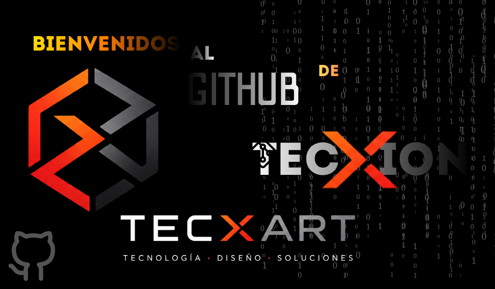
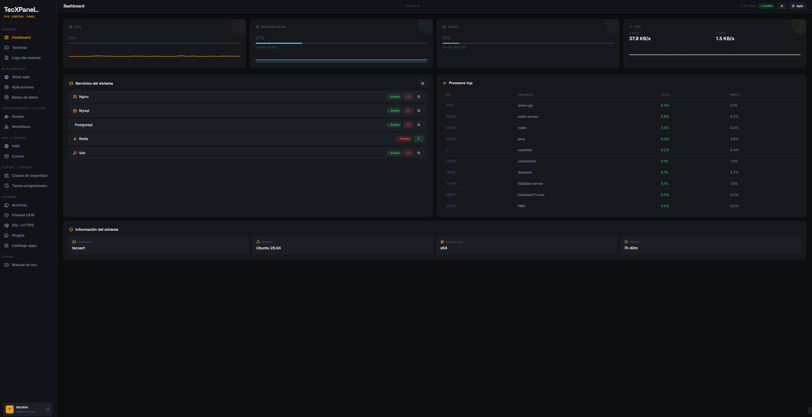
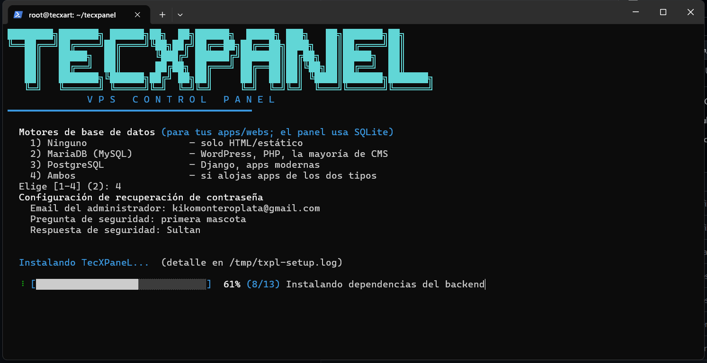
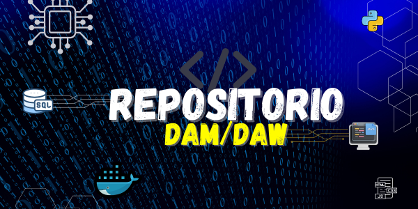

<h1 align="center">
  
</h1>

  <a href="https://www.tecxart.es"><b>🌐 Visita mi sitio web tecxart.es</b></a> •
  <a href="mailto:info@tecxart.es"><b>📧 Contáctame por Email</b></a> •
  <a href="https://x.com/kiko_mag"><b>🐦 Sígueme en X (Twitter)</b></a>

---

### 💫 Sobre mí

¡Hola! 👋 Soy estudiante de **Desarrollo de Aplicaciones Multiplataforma (DAM)**, desarrollador Frontend y Backend, y apasionado del diseño gráfico y modelado 3D.

> [!NOTE]
> Aunque mi día a día actual no está completamente vinculado a la tecnología, aprendo y programo por hobby. Creo firmemente que cuando haces algo por diversión y pasión, es cuando realmente consigues dar lo mejor de ti y crear soluciones únicas.

> [!IMPORTANT]
> **¿Tienes un proyecto o idea en mente?**
> Estoy abierto a colaboraciones y nuevos retos. Escríbeme sin compromiso a [tecxart@gmail.com](mailto:tecxart@gmail.com) o a [info@tecxart.es](mailto:info@tecxart.es).

---

### 💻 Tech Stack & Herramientas

  <!-- Programación -->
  
  
  
  
  
  
  
   
  <!-- Frameworks & Bases de Datos -->
  
  
  
  
   
  <!-- Diseño & Media -->
  
  
  

---

### 📊 GitHub Stats

  
  

  

#### 🏆 GitHub Trophies

  

---

### 🚀 Proyectos Destacados

A continuación puedes ver algunos de mis repositorios clave. ¡Te invito a explorarlos, hacer un fork o dejar una estrella! ⭐

#### 🎛️ Tecxpanel

Tecxpanel es un panel de control personalizado y dinámico para la optimización de VPS, es un proyecto que me ha llevado bastantes horas espero que os guste, es un relevo gratuito para CPanel, Plesk, u otros paneles de VPS, segúramente contenga errores y se pueda mejorar pero por eso necesito que lo compartais y me deis vuestra opinion.

<table align="center" width="100%">
  <tr>
    <td align="center" valign="middle" width="35%">
      
      <a href="https://github.com/tecxion/tecxpanel"><b>Ver Repositorio ➔</b></a>
    </td>
    <td align="center" valign="middle" width="65%">
      
      
    </td>
  </tr>
</table>

 

<table align="center" width="100%">
  <tr>
    <td width="50%" align="center" valign="top">
      <h4>🐍 Curso de Python</h4>
      
Un espacio dedicado a aprender, practicar y dominar Python desde cero.

      
        
      <a href="https://github.com/tecxion/Curso-Python"><b>Ver Repositorio ➔</b></a>
    </td>
    <td width="50%" align="center" valign="top">
      <h4>💾 Bases de Datos Oracle</h4>
      
Recursos, ejercicios y apuntes para estudiantes de DAM/DAW en FpdRioja.

      
        
      <a href="https://github.com/tecxion/Bases-de-datos-Oracle"><b>Ver Repositorio ➔</b></a>
    </td>
  </tr>
</table>

<table align="center" width="100%">
  <tr>
    <td with="50%" align="center" valign="top">
      <h4>Este es el repositorio del curos de DAM/DAW de FPD Rioja, por si alguno estudiais ahí.</h4>
      
Esta realizado un fork desde el repositorio original, hay recursos como tareas o exámenes de otros años.
 
         
       
      <a href="https://github.com/tecxion/DAM_DAW"><b>Ver Repositorio ➔</b></a>
    <td>
</table>
  >

---

### 📹 Canales de YouTube & Comunidad

Además de la programación, me apasiona la divulgación y la creación de contenido audiovisual. Te invito a pasarte por mis canales:

<table align="center" width="100%">
  <tr>
    <th align="center">Canal</th>
    <th align="center">Audiencia</th>
    <th align="center">Visualizaciones</th>
    <th align="center">Acceso</th>
  </tr>
  <tr>
    <td align="center"><b>🛸 A Vista de Dron</b></td>
    <td align="center">
      
    </td>
    <td align="center">
      
    </td>
    <td align="center">
      <a href="https://www.youtube.com/channel/UCr-3cqijQN-KcVbP1OS7u-g"><b>Ir al canal ➔</b></a>
    </td>
  </tr>
  <tr>
    <td align="center"><b>📜 Making History</b></td>
    <td align="center">
      
    </td>
    <td align="center">
      
    </td>
    <td align="center">
      <a href="https://www.youtube.com/channel/UC5qDIL9s7G1n7SG22JshzAQ"><b>Ir al canal ➔</b></a>
    </td>
  </tr>
</table>

---

### 💰 ¿Quieres apoyar mi trabajo?

Si te gusta lo que hago y quieres ayudarme a seguir creciendo y creando contenido:

  
  &nbsp;&nbsp;
  

  
  &nbsp;
  
  &nbsp;
  

